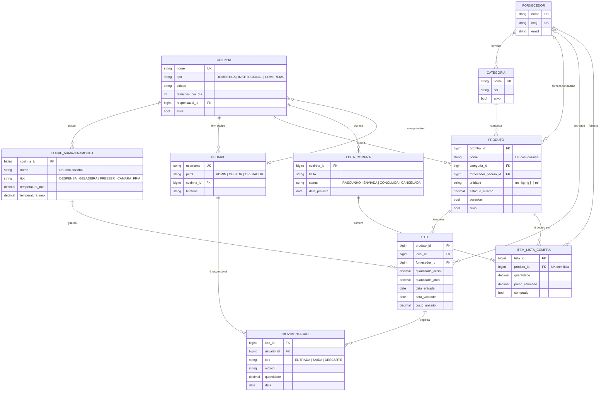

# 🍽️ Guardião da Cozinha (Django)

> Sistema web de controle de estoque para cozinhas domésticas, institucionais e comerciais.

Trabalho Prático de **GAC116 – Programação Web (UFLA)**: projeto de implementação com Django.

## 👥 Integrantes

| Nome | GitHub |
|---|---|
| Gilson dos Santos Júnior | [@RATZogun](https://github.com/RATZogun) |
| Luis Gustavo Silva Teodoro | [@Luis3Gustavo](https://github.com/Luis3Gustavo) |
| Maria Lina da Silva | [@Marialinaa](https://github.com/Marialinaa) |

## 🧩 Descrição

Cozinhas perdem alimentos por vencimento e compram errado por não saberem o que têm em estoque.
O **Guardião da Cozinha** registra cada entrada de mercadoria como um **lote** com validade e local
de armazenamento, controla o consumo e o descarte por **movimentações rastreáveis**, alerta sobre
produtos **abaixo do estoque mínimo** ou **perto de vencer** e gera **listas de compras** a partir
do que está faltando.

Uma mesma instalação atende várias cozinhas (um restaurante universitário, uma cantina, uma
casa). Cada usuário pertence a uma cozinha e enxerga apenas os dados dela.

### Perfis de usuário

| Perfil | Acesso | O que pode fazer |
|---|---|---|
| **Administrador** | Admin, todas as cozinhas | Tudo: cozinhas, usuários, perfis, cadastros e estoque |
| **Gestor** | Admin, só a própria cozinha | Produtos, lotes, locais, listas de compras; registra saídas e descartes; consulta usuários |
| **Operador** | Área do usuário (Checkpoint 2) | Consulta o estoque e registra entradas e saídas |

As permissões de cada perfil ficam em [`apps/contas/perfis.py`](apps/contas/perfis.py) e são
aplicadas como grupos do Django automaticamente a cada `migrate`.

## 🛠️ Tecnologias

| Camada | Tecnologia |
|---|---|
| Linguagem | Python 3.10+ |
| Framework | Django 5.2 LTS (arquitetura MVT) |
| Banco de dados | SQLite (padrão) ou PostgreSQL (configurável por `.env`) |
| Ambiente administrativo | Django Admin com o tema **Unfold** (claro/escuro, filtros, painel) |
| Interface do usuário | Bootstrap 5.3 + Bootstrap Icons, tema claro/escuro |
| Testes | `django.test` (TestCase) |

## 🚀 Instalação

Pré-requisitos: Python 3.10 ou mais recente e Git.

```bash
git clone https://github.com/RATZogun/Kitchen_Guardian_Django.git
cd Kitchen_Guardian_Django

python -m venv .venv
source .venv/bin/activate          # Windows: .venv\Scripts\activate
pip install -r requirements.txt

cp .env.example .env               # opcional: SQLite funciona sem .env
python manage.py migrate           # cria as tabelas e os grupos de perfis
python manage.py popular_demo      # opcional: dados de demonstração
```

Para usar PostgreSQL, instale `psycopg[binary]`, crie o banco e preencha `DB_ENGINE=postgresql`
e as variáveis `DB_*` no `.env`.

## ▶️ Execução

```bash
python manage.py runserver
```

- Página inicial: <http://127.0.0.1:8000/>
- Administração: <http://127.0.0.1:8000/admin/>

Com os dados de demonstração, todos os usuários usam a senha `guardiao123`:

| Usuário | Perfil | Cozinha |
|---|---|---|
| `admin` | Administrador | todas |
| `gestor1` / `operador1` | Gestor / Operador | Restaurante Universitário |
| `gestor2` / `operador2` | Gestor / Operador | Cantina Sabor Mineiro |
| `gestor3` / `operador3` | Gestor / Operador | Casa da Família Souza |

Sem os dados de demonstração, crie um administrador com `python manage.py createsuperuser`.

Testes automatizados:

```bash
python manage.py test
```

## ✨ Principais funcionalidades

**Checkpoint 1 (ambiente administrativo)**

- Painel inicial com indicadores, lotes vencidos ou vencendo, produtos abaixo do mínimo e
  gráfico das movimentações dos últimos 14 dias.
- CRUD de cozinhas, locais de armazenamento, categorias, fornecedores, produtos, lotes,
  listas de compras e usuários.
- **Entrada de mercadoria** pelo cadastro de lote: gera automaticamente a movimentação de entrada
  no nome de quem registrou.
- **Saídas e descartes** validados: não deixam o lote negativo e não aceitam datas futuras.
  O histórico de movimentações é imutável (sem edição nem exclusão).
- **Filtros** em todas as listagens: nível de estoque, risco de validade, situação do lote,
  intervalos de data e de quantidade, categoria, fornecedor, cozinha, tipo de local, perfil...
- **Ações em lote**: gerar lista de compras com os produtos abaixo do mínimo, descartar lotes
  vencidos, desativar produtos, marcar listas como enviadas ou concluídas.
- Badges na barra lateral com a quantidade de produtos abaixo do mínimo e de lotes em risco.
- Gestor restrito à própria cozinha em listagens, formulários e filtros.

**Checkpoint 2 (previsto)**: login, logout e cadastro na área do usuário; telas Bootstrap para
o operador consultar o estoque e registrar entradas e saídas; relatórios.

## 🗃️ Modelagem do banco de dados



Principais regras de integridade:

- O saldo de um produto é a soma das quantidades restantes dos seus lotes, e só muda por
  movimentações ([`apps/estoque/services.py`](apps/estoque/services.py)).
- Restrições no banco: lote nunca negativo nem acima do recebido, quantidade de movimentação
  positiva, estoque mínimo não negativo e nomes únicos por cozinha.
- O lote só pode ficar num local da mesma cozinha do produto. Produto perecível exige validade.
- Categorias com produtos ativos não podem ser desativadas. Exclusões de produtos são lógicas
  (campo `ativo`), para preservar o histórico.

## 📁 Estrutura do projeto

```
Kitchen_Guardian_Django/
├── config/                 # settings (Unfold, banco, idioma), urls, wsgi/asgi
├── apps/
│   ├── contas/             # Usuario (AbstractUser + perfil + cozinha), perfis/grupos
│   ├── cozinhas/           # Cozinha, LocalArmazenamento
│   ├── estoque/            # Categoria, Fornecedor, Produto, Lote, Movimentacao
│   │   ├── services.py     #   regras de entrada, saída e descarte
│   │   └── filters.py      #   filtros personalizados do admin
│   ├── compras/            # ListaCompra, ItemListaCompra
│   └── core/               # página inicial, painel do admin, escopo por cozinha,
│       └── management/     #   comando popular_demo
├── templates/
│   ├── base.html           # layout Bootstrap com alternância de tema
│   ├── core/inicio.html
│   └── admin/index.html    # painel do admin (componentes do Unfold)
├── static/                 # CSS e imagens
├── requirements.txt
└── manage.py
```

## 🌿 Fluxo de branches

- `main`: versões entregues (Checkpoint 1, Checkpoint 2).
- `develop`: integração do que está pronto.
- `feature/<nome>`: cada funcionalidade nova, com merge em `develop`.
